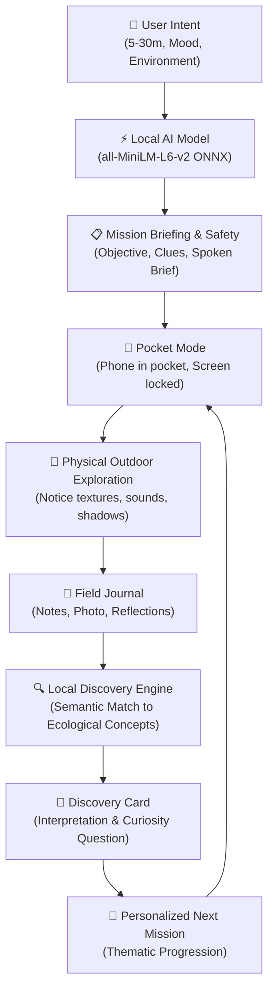

# 🌿 SIDEQUEST — An Open-Source AI Outdoor Exploration Game

> Built for the **MLH / Hacktoberfest 2026 Open-Source AI Challenge**, Week 1: *"Touch Grass"*.

**SIDEQUEST** transforms ordinary outdoor environments into personalized exploration games. The user receives an investigation tailored to their time and surroundings, leaves their phone in their pocket, explores the physical world, and returns to log what they discovered. An open-weight sentence-embedding AI model running **100% locally in the browser** connects their field notes to ecological insights and selects increasingly relevant follow-up missions.

Core philosophy: **The screen should help someone enter the world, not compete with it.**

---

## 🌟 Key Differentiators

1. **Local Semantic Intelligence:** Computes real 384-dimensional sentence embeddings in-browser via Transformers.js (`all-MiniLM-L6-v2`, Apache-2.0). Zero cloud API latency or fees.
2. **Zero-Cloud Core Experience:** Works completely offline after initial model weight download. No account required, no remote databases, zero tracking telemetry.
3. **Observation-Driven Mission Evolution:** Your field notes feed directly into the local Discovery Engine, which recommends semantically linked investigations (e.g., pavement plants → microclimates → storm runoff).
4. **Screen-Minimal "Pocket Mode":** Briefs you once with optional audio read-aloud and a harmonic bell chime, then asks you to lock your screen and put your phone in your pocket.
5. **User-Owned Exploration Archives:** Field observations, photos, and curiosity milestones persist strictly inside browser IndexedDB, with instant JSON data export and total erasure controls.

---

## 🔄 The Evolving Exploration Loop



---

## 🧠 Why Open-Source AI Makes SIDEQUEST Better

| Dimension | Hosted Closed Cloud API (e.g. Proprietary LLM) | SIDEQUEST (Open-Weight In-Browser Sentence Transformer) |
| :--- | :--- | :--- |
| **Connectivity in Nature** | Fails in remote parks, wooded trails, or dead zones with poor mobile cell signal. | **100% offline.** Once cached, runs locally inside the browser using WebAssembly & ONNX Runtime Web. |
| **Privacy & Intimacy** | User field notes, photos, and personal reflections get uploaded to third-party servers. | **Zero cloud egress.** Field notes never leave client-side IndexedDB. |
| **Cost & Longevity** | Vulnerable to API price hikes, token billing, rate quotas, and service deprecation. | **Permanent zero-cost.** Open-weight model distributed under Apache 2.0 with unlimited free usage. |
| **Latency** | 800ms–3000ms network round-trip for remote completions. | **5ms–20ms** real-time local cosine similarity search across all 36 missions. |
| **Verifiability** | Black-box output with hidden system prompts and non-deterministic hallucination risk. | **Inspectable vector embeddings.** Dedicated AI Lab lets users inspect raw floating-point vectors and cosine math. |

---

## 🏗️ Technical Architecture

- **Runtime & UI:** React 19, TypeScript, Vite, Tailwind CSS v4.
- **Local AI Inference Runtime:** `@xenova/transformers` (Transformers.js) loading `Xenova/all-MiniLM-L6-v2` in quantized ONNX format (~23 MB) via WebAssembly.
- **Local Fallback Engine:** Deterministic TF-IDF index + category/duration composite scoring for instant fallback before model download.
- **Data Persistence:** Client-side IndexedDB (`sidequest_db`) with fallback to localStorage.
- **Acoustic Feedback:** Web Audio API zero-asset harmonic bell synthesizer (528 Hz chime) and Web Speech API synthesis for hands-free accessibility.
- **Testing Framework:** Vitest with comprehensive integration and unit test coverage.
- **Offline PWA:** Web App Manifest (`manifest.json`) and Service Worker (`sw.js`).

---

## 🗂️ Curated Mission Library (36 Missions)

SIDEQUEST ships with **36 field-tested outdoor investigations** designed specifically for real-world urban, campus, garden, and neighborhood environments:
- **Urban Botany & Resilience:** *The Survivor* (plants in concrete cracks), *The Lichen Chronicles*, *The Boundary Creepers*, *The Balcony Oasis*.
- **Acoustic Ecology:** *The Invisible City* (unnoticed soundscapes), *The Acoustic Horizon*, *Birdsong Triangulation*.
- **Physics & Microclimates:** *The Shade Experiment*, *The Breeze Corridor*, *The Microclimate Mystery*, *Thermal Memory*, *The Shadow Clock*.
- **Animal Architecture:** *Ant Highway Architects*, *The Silk Engineer* (spider web physics), *The Pollinator Patrol*, *Soil Surface Crypts*.
- **Hydrology & Materials:** *The Water Detective*, *The Puddle Cosmos*, *The Artificial Creek*, *Rust and Renewal*, *Concrete Efflorescence*.
- **Phenomenology & Time:** *The Five-Minute Phenomenon*, *Canopy Kaleidoscope*, *The Twilight Transition*, *Geometric Echoes*.

> **Safety Notice Built-In:** All missions enforce strict safety guidelines: never touch unknown organisms, never eat wild plants, avoid traffic, and never trespass on private property.

---

## ⏱️ 60–90 Second Demo Script

1. **Launch:** Open the app. Notice the warm editorial field-journal aesthetic.
2. **Configure:** Click **"Begin New Expedition"**. Choose **10 min**, **Curious** mood, **Campus** environment, and type *"yellow weeds in concrete"* into the free-text prompt.
3. **AI Ranking:** See the local model score the 36 missions in real time (~12ms) and select **"The Survivor"** as the #1 match.
4. **Briefing:** Read the narrative briefing and 3 observable clues. Click **"Read Aloud"** to hear the spoken accessibility prompt.
5. **Pocket Mode:** Tap **"Enter Pocket Mode"**. Notice the minimalist distraction-free screen. Tap the ambient audio chime. Simulate stepping outside.
6. **Return & Log:** Click **"I'm Back (Record Field Notes)"**. Write: *"Found a small plant growing out of a concrete crack. Mortar had crumbled into fine soil around its stem."*
7. **Discovery Card:** Submit the note. Watch the local Discovery Engine generate the **Discovery Card**, highlighting *Botanical Resilience & Urban Colonization* with an 88% confidence score.
8. **Next Mission:** See the evolved follow-up mission (*The Microclimate Mystery*). Click **"Accept Mission"** or view **"My Expeditions"** to verify that your notes and unlocked curiosity milestone (*First Bloom*, *Pavement Pioneer*) persisted in IndexedDB.
9. **Diagnostics:** Open **AI Lab** to view live vector embeddings, test custom queries, and switch between neural and deterministic scoring.

---

## 🧪 Automated Test Suite

Run the full Vitest automated test suite:

```bash
npm test
```

Verified test coverage includes:
- **`tests/primaryUserJourney.test.ts`:** Full 10-step primary user journey end-to-end test.
- **`tests/missionSelection.test.ts`:** Duration, environment, mood, diversity penalty, and semantic similarity scoring.
- **`tests/discoveryEngine.test.ts`:** Semantic theme matching, empty/malformed text resilience, follow-up progression.
- **`tests/storage.test.ts`:** IndexedDB persistence, mid-quest browser refresh recovery, and complete data deletion.
- **`tests/safetyAndEthics.test.ts`:** Verifies safety notices and absence of hazardous instructions across all 36 missions.
- **`tests/vectorMath.test.ts`:** Dot products, magnitudes, unit normalization, and cosine clamping.

---

## 🚀 Installation & Local Development

### Prerequisites
- Node.js v18+ (tested on Node v24.14.0)
- npm v9+

### Setup Commands
```bash
# Clone the repository
git clone https://github.com/your-username/sidequest.git
cd sidequest

# Install dependencies
npm install

# Start local development server
npm run dev
```

Open [http://localhost:5173](http://localhost:5173) in your browser.

### Production Build
```bash
npm run build
npm run preview
```

---

## 🔒 Privacy & Offline Behavior

- **Initial Load:** Downloads static HTML/JS/CSS assets and begins background caching.
- **First Model Run:** Fetches the quantized `Xenova/all-MiniLM-L6-v2` model weights (~23 MB) from Hugging Face CDN.
- **Subsequent Runs:** Operates **100% offline** via Cache API.
- **No Cloud Egress:** Your field notes, reflections, uploaded photos, and location tags are never transmitted to any external server.

---

## ⚠️ Limitations & Future Roadmap

- **Browser Lock-Screen Timers:** Mobile operating systems throttle background JavaScript timers when screens lock. SIDEQUEST uses hardware clock delta timestamps upon unlock to prevent timer drift, but native background audio chimes require mobile native wrapper integration (Capacitor/PWA push).
- **Vision Model Roadmap:** Future updates will explore integrating a client-side quantized MobileNet or CLIP model for offline flora pattern classification directly on uploaded photographs.
- **Spatial Mapping:** Future releases could add optional privacy-first offline topological trail vector rendering.

---

## 📄 License & Attribution

- **Application Code:** [MIT License](./LICENSE)
- **Embedding Model:** `sentence-transformers/all-MiniLM-L6-v2` (Apache-2.0 License, Microsoft & Hugging Face)
- **Icons:** `lucide-react` (ISC License)
